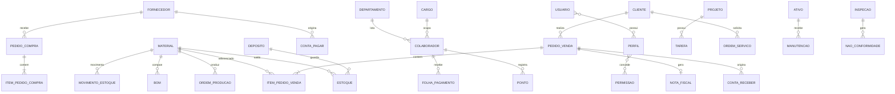

# ERP Avançado — Documentação do Projeto Final de Banco de Dados Avançado

## 1. Visão geral
ERP modular com banco unificado (PostgreSQL), um *schema* por módulo e backend em microsserviços.
Arquivo de implementação da Unidade 1: `erp_schema.sql`.

## 2. Modelagem de dados
### 2.1 Modelo conceitual (ER simplificado)

### 2.2 Modelo lógico
Todas as tabelas estão na 3ª Forma Normal: chaves primárias/estrangeiras, `CHECK` de domínio,
`UNIQUE` para chaves naturais (CNPJ, SKU, login) e colunas calculadas (`liquido`, `severidade`)
via `GENERATED ALWAYS AS`.

### 2.3 Modelo físico
- Tipos: `NUMERIC` para dinheiro, `TIMESTAMPTZ` para datas/horas, `JSONB` para payloads e auditoria.
- Particionamento: `sys.log_auditoria` por faixa anual (`RANGE`).
- Índices: parciais (títulos em aberto, pedidos não faturados), GIN `pg_trgm` (busca textual), GIN em JSONB, compostos por consulta frequente.
- Ferramenta recomendada: DbSchema (importar o `.sql` por engenharia reversa).

## 3. Cobertura dos módulos
| Módulo | Schema | Principais tabelas |
|---|---|---|
| Financeiro (FI) | `fi` | plano_contas, lancamento, conta_pagar, conta_receber, orcamento, extrato_bancario, movimento_caixa, tributo, obrigacao_acessoria, imposto_documento |
| RH | `rh` | colaborador, cargo, ponto, folha_pagamento, avaliacao_desempenho, beneficio, vaga, candidato |
| Materiais (MM) | `mm` | material, estoque, movimento_estoque, pedido_compra, fornecedor, inventario, inventario_item |
| Vendas/CRM (SD) | `sd` | cliente, oportunidade, contrato, pedido_venda, nota_fiscal |
| Produção (PP) | `pp` | bom, ordem_producao, mrp, apontamento_producao |
| Projetos (PS) | `ps` | projeto, tarefa |
| Serviços (SM) | `sm` | ordem_servico (SLA) |
| Qualidade (QM) | `qm` | inspecao, nao_conformidade, plano_amostragem |
| Ativos (AM) | `am` | ativo, manutencao |
| GRC | `grc` | risco, consentimento_lgpd, sod_regra (segregação de funções), auditoria_interna |
| BI | `bi` | views e view materializada |
| SYS | `sys` | usuario, perfil, permissao, log_auditoria, metrica_performance |
| API/IoT/Blockchain | `api` | integracao_log, leitura_iot (+ `sd.contrato.hash_blockchain`) |

O módulo fiscal (12) agora tem estrutura dedicada: `fi.tributo`, `fi.obrigacao_acessoria` (SPED/EFD/eSocial) e `fi.imposto_documento` (impostos por NF). O módulo mobile/portal (13) é atendido pelas APIs/Frontend (Unidades 2 e 3).

## 2b. Correções e ampliações desta revisão
- Partição de auditoria ampliada para 2025–2028 (cobre o ciclo de vida do projeto).
- Novas procedures: `fi.sp_conciliar_extrato` (conciliação bancária automática) e `fi.sp_calcular_impostos_nota` (ICMS/PIS/COFINS por NF).
- Novas views BI: `bi.vw_impostos_periodo` (tributos por competência) e `bi.vw_produtividade` (produzido × refugo por ordem).
- Trilhas de auditoria estendidas às novas tabelas críticas (extrato, obrigações fiscais, vagas/candidatos, inventário, MRP).

## 4. Recursos de banco implementados
- **Triggers:** atualização de estoque, recálculo do total do pedido, bloqueio de pedido faturado, auditoria genérica.
- **Stored procedures:** `sp_faturar_pedido`, `sp_receber_compra`, `sp_depreciar_ativos`, `sp_gerar_folha`, `sp_baixar_recebimento`, `fi.sp_conciliar_extrato`, `fi.sp_calcular_impostos_nota`.
- **Functions:** `fn_calcula_inss`, `fn_cadastra_colaborador` (criptografia de CPF).
- **Views:** vendas mensais, estoque crítico, fluxo de caixa, inadimplência, SLA, margem por produto (materializada), impostos por competência, produtividade da produção.
- **Sequences:** pedidos de venda/compra, ordens de produção/serviço, NF.

## 5. Controle de acesso (RBAC)
| Perfil | Acesso |
|---|---|
| CEO / DBA | Tudo (inclui auditoria e dados sensíveis) |
| Diretor | Leitura em todos os módulos + aprovação de pedidos |
| Gerente | Operação em MM, SD, PP, PS, SM, QM; leitura FI/BI; RH só via view pública |
| Supervisor | Registros operacionais; sem financeiro/folha |
| Analista | Somente leitura em BI |

## 6. Segurança e governança
- Senhas com `crypt()/bcrypt`; CPF com `pgp_sym_encrypt` (chave fora do banco, ex.: Vault).
- Auditoria JSONB (antes/depois) → exportação ao ELK/Splunk via Logstash JDBC.
- LGPD: `grc.consentimento_lgpd`; MDM: cliente/material/fornecedor como cadastros mestres únicos.

## 7. Alta disponibilidade
Replicação *streaming* (primário + réplica), `pg_basebackup` + WAL archiving (PITR), Patroni + HAProxy/PgBouncer para failover e balanceamento de leitura.

## 8. Controle de versão e CI/CD
- Flyway: `V1__schema_base.sql` (este arquivo), `V2__...` para cada alteração.
- Pipeline (GitHub Actions): subir PostgreSQL em container → `flyway migrate` → testes **pgTAP** → testes de API → deploy.

## 9. Arquitetura (3 unidades)
1. **Data Layer:** PostgreSQL (OLTP), MongoDB/Redis (documentos, cache, sessões), Data Warehouse (esquema estrela alimentado por ETL a partir de `bi`).
2. **Backend:** microsserviços por módulo, REST/GraphQL, orquestração com motor de regras.
3. **Frontend:** React + dashboards (Metabase/Power BI) e portais de cliente, fornecedor e colaborador.

## 10. Requisitos e rastreabilidade
| Requisito | Funcionalidade | Tabelas | Código |
|---|---|---|---|
| RF01 Faturar pedido | NF + título + baixa de estoque | pedido_venda, nota_fiscal, conta_receber, movimento_estoque | `sd.sp_faturar_pedido` |
| RF02 Receber compra | Entrada + conta a pagar | pedido_compra, movimento_estoque, conta_pagar | `mm.sp_receber_compra` |
| RF03 Folha | Cálculo mensal | folha_pagamento, cargo | `rh.sp_gerar_folha` |
| RF04 Depreciação | Mensal automática | ativo | `am.sp_depreciar_ativos` |
| RF05 Conciliação bancária | Casamento extrato × lançamentos | extrato_bancario, lancamento | `fi.sp_conciliar_extrato` |
| RF06 Obrigações acessórias | SPED/EFD/eSocial | obrigacao_acessoria | seeds + view `bi.vw_impostos_periodo` |
| RF07 MRP | Demanda + previsão IA | mrp, material | `pp.mrp` |
| RNF01 Auditoria | Log de alterações | log_auditoria | `sys.fn_auditoria` |
| RNF02 RBAC | Perfis por cargo | roles `erp_*` | seção 15 do SQL |

Gestão no Jira/Azure DevOps com cada requisito ligado a *issue*, *commit* e migração.

## 10b. Implementações de requisitos avançados (V5)
- **Obrigações acessórias:** `fi.fn_gerar_sped_efd` e `rh.fn_gerar_esocial`
  geram os arquivos (layout didático) a partir dos dados reais;
  `fi.sp_registrar_entrega` marca a entrega. Endpoints: `/api/adv/sped-efd`,
  `/api/adv/esocial`.
- **IA/ML:** `pp.fn_previsao_demanda` — regressão linear (REGR_SLOPE) sobre
  12 meses de vendas por material, com rótulo de tendência
  (ALTA/QUEDA/ESTÁVEL); `pp.sp_gerar_mrp` grava o resultado em `pp.mrp`
  (`demanda_gerada_por_ia`). Endpoint: `/api/adv/previsao-demanda`.
- **Detecção de fraude:** views `grc.vw_suspeitas_auditoria` (alterações
  financeiras fora do horário comercial, deletes em vendas) e
  `grc.vw_suspeitas_valor` (notas outliers por cliente). Endpoints:
  `/api/adv/fraude/*`.
- **Exportação ELK/BI:** `sys.fn_auditoria_json` devolve a auditoria em JSON
  por evento, pronto para o ingest do Logstash/Splunk HEC
  (`/api/adv/auditoria/json`); CSV de qualquer view BI para Power BI/Metabase
  (`/api/adv/bi/<view>.csv`).

## 11. Tecnologias emergentes e roadmap
- **IA/ML:** previsão de demanda implementada em SQL (`pp.fn_previsao_demanda`); detecção de fraude em `grc.vw_suspeitas_*`.
- **IoT:** sensores gravam em `api.leitura_iot` (processamento na borda, envio em lote).
- **Blockchain:** hash do contrato em `sd.contrato.hash_blockchain`.
- **Roadmap:** T1 núcleo FI/MM/SD → T2 RH/PP/QM → T3 PS/SM/AM/GRC → T4 BI/ML/IoT. Revisão trimestral de performance (`EXPLAIN ANALYZE`, `pg_stat_statements`).

## 12. Documentação e treinamento
Documentação modular por schema em Confluence/GitBook; treinamentos trimestrais (novas features, segurança, LGPD).
